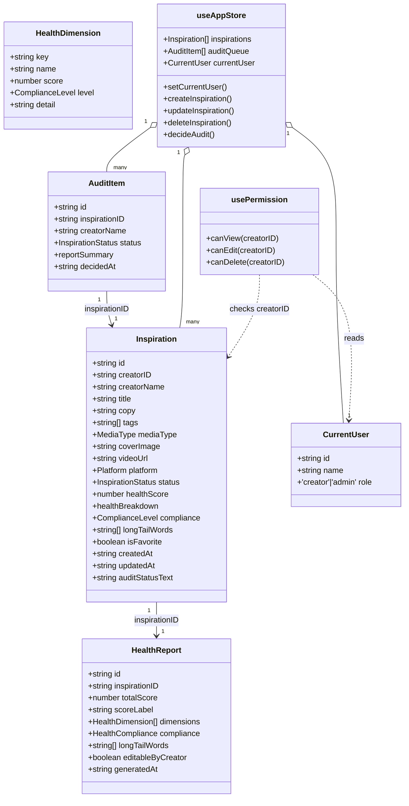
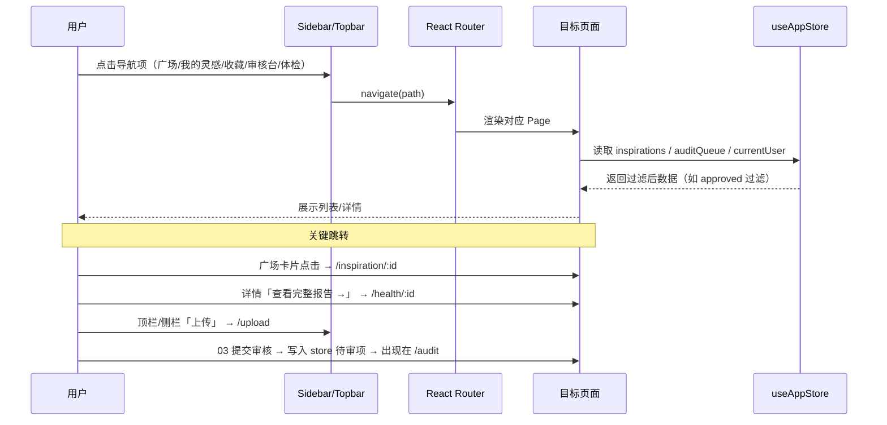
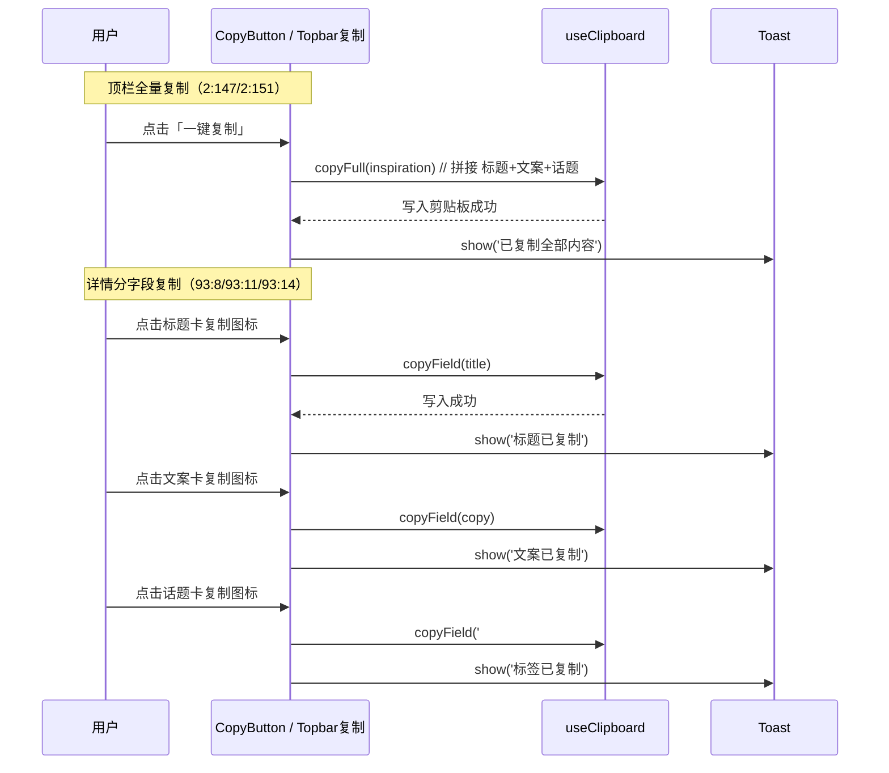
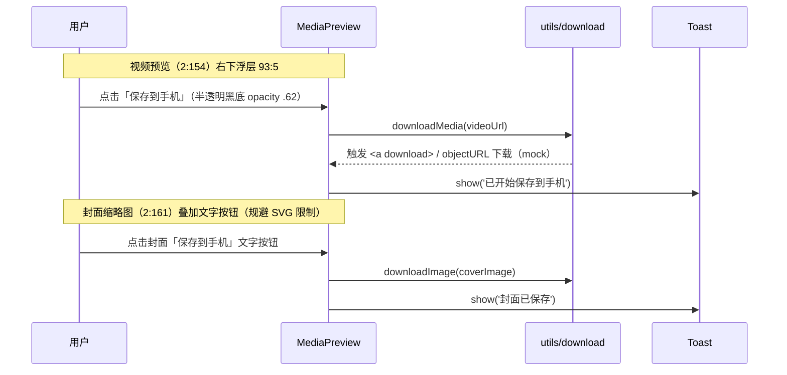
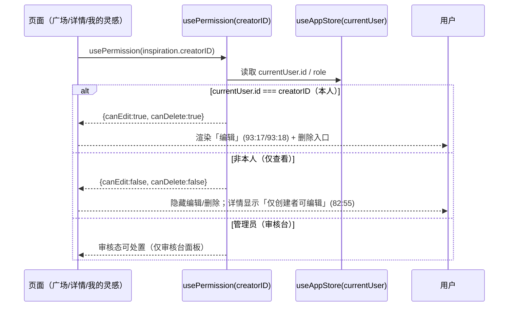

# LinJi·灵集 初版 架构设计 + 任务分解

> 文档版本：初版（v0.1）  
> 作者：高见远（Gao，架构师）  
> 配套文档：PRD-初版.md（v0.1）、开发文档.md（v1.1）  
> 技术栈：Vite + React + TypeScript + React Router + MUI + Tailwind CSS + Zustand  
> 范围：前端原型 + 前端 mock 数据，无真实后端（后端相关项 Deferred，见 PRD §7）

---

## 1. 技术选型与理由

| 维度 | 选型 | 理由 |
| --- | --- | --- |
| 构建工具 | **Vite 5** | 启动快、HMR 友好、TS 零配置；适合原型快速迭代。 |
| 框架 | **React 18 + TypeScript** | 组件化契合 6 页面 + 卡片组件复用；TS 保证 `Inspiration`/`HealthReport` 等 mock 数据契约清晰，便于后续接真实后端。 |
| 路由 | **React Router v6**（`react-router-dom`） | 6 个页面为典型「侧栏导航 + 内容区」结构，声明式路由 + `<Outlet>` 与布局壳天然契合；支持 `:id` 动态参数（详情页、体检页）。 |
| 组件库 | **MUI v5（@mui/material + @mui/icons-material）** | 开发文档已定义颜色/字体/状态色 token，MUI `theme` 可直接映射；图标用 MUI `ContentCopy` 等矢量图标，**规避 ardot SVG 限制（开发文档 §7.2）**。 |
| 样式 | **Tailwind CSS 3（仅布局/间距工具类）** | 用于侧栏 232px、顶栏 64px、卡片瀑布流等结构布局；MUI 负责交互组件样式，二者职责分离（见 §7 约定）。 |
| 状态管理 | **Zustand 4（默认）** | 轻量、无 Provider 嵌套、selector 精准订阅。初版核心是「一份 mock 内存数据（灵感列表 + 审核队列 + 当前用户）」被多页面共享并修改（审核状态切换、上传新增），Zustand 单 store + selectors 比 Context 更简洁、避免重渲染。Context 仅作为备选（若团队更熟悉），但默认选 Zustand。 |
| Mock 数据层 | **`data/` 模块：types + mock 种子 + service 层 + 本地评分器** | service 层全部返回 `Promise`（带 `setTimeout` 模拟异步），后续接真实后端时**只换实现、不改调用方**。评分用本地函数（见 §3 / §8.5），数据更真实。 |

### 1.1 目录结构与文件列表

```
linji/                              # 前端工程根（与 PRD/开发文档同仓库，建议放 web/ 子目录，此处以根示意）
├── index.html                      # Vite 入口 HTML
├── package.json                    # 依赖与脚本
├── tsconfig.json / tsconfig.node.json
├── vite.config.ts                  # Vite + React 插件 + 别名 @ -> src
├── tailwind.config.js              # Tailwind 配置（content 扫描 src）
├── postcss.config.js               # Tailwind/Autoprefixer
├── .eslintrc.cjs                   # 代码规范（命名/未用变量）
└── src/
    ├── main.tsx                    # 入口：挂载 App + Router + MUI ThemeProvider
    ├── App.tsx                     # 路由壳 + 全局 Provider（Zustand 无需 Provider）
    ├── router/
    │   ├── index.tsx               # 路由表：6 页面 + 收藏占位 + 详情/体检动态路由
    │   └── paths.ts                # 路由路径常量（避免硬编码字符串）
    ├── store/
    │   ├── useAppStore.ts          # Zustand：inspirations / auditQueue / currentUser / actions
    │   └── selectors.ts            # 派生选择器（过滤 approved、按 creatorID 过滤等）
    ├── data/
    │   ├── types.ts                # 全部 TS interface（见 §3）
    │   ├── mock/
    │   │   ├── inspirations.ts     # 灵感种子（覆盖卡片/详情/审核台/我的灵感/体检所需字段）
    │   │   ├── reports.ts          # 体检报告种子（含低分/风险/阻断边界样本）
    │   │   └── users.ts            # mock 用户（创建者 / 管理员 演示视角）
    │   ├── services/
    │   │   ├── inspirationService.ts # 异步 CRUD mock（list/get/create/update/delete，Promise+delay）
    │   │   ├── auditService.ts        # 审核队列读取 / 通过 / 驳回（内存切换）
    │   │   └── healthService.ts       # 调用 scorer 生成报告（上传即生成）
    │   └── health/
    │       └── scorer.ts           # 本地评分函数（文本长度/话题数/标题利益点/封面有无 → 维度分）
    ├── hooks/
    │   ├── usePermission.ts        # usePermission(creatorID) → {canView, canEdit, canDelete}
    │   ├── useClipboard.ts         # 复制封装（navigator.clipboard）+ toast
    │   └── useCurrentUser.ts       # 读取 store 当前用户/角色
    ├── components/
    │   ├── layout/
    │   │   ├── AppLayout.tsx       # 232px 侧栏 + 64px 顶栏 + <Outlet/>
    │   │   ├── Sidebar.tsx         # Logo + 工作区分组 + 导航 + 用户卡（节点 2:1 区域）
    │   │   ├── Topbar.tsx          # 顶栏：一键复制(2:147/2:151) + 角色切换器 + 上传入口
    │   │   └── NavItem.tsx         # 侧栏导航项（高亮当前路由）
    │   ├── common/
    │   │   ├── HealthBadge.tsx     # 健康分徽标（82:53），色阶随分数
    │   │   ├── StatusChip.tsx      # 状态标签：待审/已通过/已驳回（绿/红/琥珀）
    │   │   ├── CopyButton.tsx      # 复制图标按钮（MUI ContentCopy，描边深灰 #52525B）
    │   │   ├── SaveToPhoneBtn.tsx  # 保存到手机文字按钮（视频浮层 93:5 / 封面叠加）
    │   │   ├── MediaPreview.tsx    # 视频(2:154)/封面(2:161)预览 + 保存浮层
    │   │   └── Toast.tsx           # 复制/保存成功提示（MUI Snackbar 封装）
    │   └── inspiration/
    │       ├── InspirationCard.tsx # 广场/我的灵感卡片(2:75)：封面+信息区+健康徽标+编辑按钮(93:17 根节点)
    │       ├── ReportPanel.tsx     # 体检报告面板：维度分 + 合规 + 长尾词（详情/体检页共用）
    │       └── AuditPanel.tsx      # 审核台面板：只读摘要 + 通过/驳回（93 系列）
    ├── pages/
    │   ├── PlazaPage.tsx           # 01 灵感广场：瀑布流（仅 approved）
    │   ├── DetailPage.tsx          # 02 灵感详情：分字段复制 + 保存 + 只读提示(82:55)
    │   ├── UploadPage.tsx          # 03 上传灵感：表单 + 即时报告 + 提交审核
    │   ├── AuditPage.tsx           # 04 审核台：待审队列 + 审核面板
    │   ├── MinePage.tsx            # 05 我的灵感：统计卡 + 本人列表（编辑/删除）
    │   ├── HealthPage.tsx          # 06 灵感体检：完整报告（80:1）
    │   └── FavoritesPage.tsx       # 我的收藏：占位/基础展示（PRD §8.3）
    ├── styles/
    │   ├── tokens.ts               # 颜色/字体/布局常量（直接引用开发文档 §4）
    │   ├── theme.ts                # MUI theme：palette/typography 映射 tokens
    │   └── global.css              # Tailwind 指令 + 全局字体（Noto Sans SC / Inter）
    └── utils/
        ├── clipboard.ts            # 写入剪贴板（标题/文案/标签/全量拼接）
        └── download.ts             # 保存到手机 mock 下载（objectURL / 占位资源）
```

---

## 2. 页面与组件映射（对齐设计稿节点）

| 页面 | 顶层节点 | 关键组件 / 节点 | 说明 |
| --- | --- | --- | --- |
| 01 灵感广场 | `2:1` | `InspirationCard`(2:75)、封面(2:76)、信息区(2:82)、健康徽标(82:53)、编辑按钮(93:17→93:18) | 仅 `status==='approved'`；卡片瀑布流 |
| 02 灵感详情 | `2:100` | 顶栏复制(2:147/2:151)、标题卡(2:167/2:168 + 93:8)、文案卡(2:181/2:182 + 93:11)、话题卡(2:186/2:187 + 93:14)、视频(2:154 + 93:5)、封面(2:161)、只读提示(82:55) | 分字段复制 + 保存 + 权限门控只读 |
| 03 上传灵感 | `2:220` | 表单字段 + 即时 `ReportPanel` + 提交按钮 | 提交即生成 mock 待审项 |
| 04 审核台 | `2:353` | `AuditPanel` 列表 + 只读摘要 + 通过/驳回 | 管理员视角；状态内存切换 |
| 05 我的灵感 | `2:494` | 统计卡 + 本人列表（复用 `InspirationCard`，门控编辑/删除） | 本人 `creatorID` 过滤 |
| 06 灵感体检 | `80:1` | 完整 `ReportPanel`（标题吸引力/文案完整度/话题覆盖/封面表现 + 合规 + 长尾词） | 各页「查看完整报告 →」目的地 |

---

## 3. 数据模型（TypeScript interface）

```ts
// ===== 基础枚举类型 =====
export type Platform = 'douyin' | 'xiaohongshu';          // 抖音 / 小红书
export type MediaType = 'image' | 'video';
export type InspirationStatus = 'pending' | 'approved' | 'rejected'; // 待审 / 已通过 / 已驳回
export type ComplianceLevel = 'pass' | 'warn' | 'block';   // 通过(绿) / 风险(琥珀) / 阻断(红)

// ===== 体检维度（标题吸引力 / 文案完整度 / 话题覆盖 / 封面表现）=====
export interface HealthDimension {
  key: 'title' | 'copy' | 'topics' | 'cover';
  name: string;            // '标题吸引力' | '文案完整度' | '话题覆盖' | '封面表现'
  score: number;           // 0-100
  level: ComplianceLevel;  // 维度级通过/风险/阻断
  detail: string;          // 维度说明文案
}

// ===== 合规结论 =====
export interface HealthCompliance {
  level: ComplianceLevel;          // pass | warn | block
  blockingReason: string | null;   // 硬阻断原因（block 时非空）
}

// ===== 体检报告（全生命周期对象，开发文档 §3.3）=====
export interface HealthReport {
  id: string;
  inspirationID: string;
  totalScore: number;          // 经验健康分 0-100
  scoreLabel: string;          // 固定：'内部经验模型 · 非平台权威数据'
  dimensions: HealthDimension[];// 4 个维度（标题吸引力/文案完整度/话题覆盖/封面表现）
  compliance: HealthCompliance;
  longTailWords: string[];     // 长尾词建议[]
  editableByCreator: boolean;
  generatedAt: string;         // ISO 8601 UTC
}

// ===== 灵感对象（核心业务实体）=====
export interface Inspiration {
  id: string;
  creatorID: string;                       // 创建者 ID（权限门控依据）
  creatorName: string;
  title: string;                           // 灵感标题
  copy: string;                            // 文案正文
  tags: string[];                          // 话题标签[]，如 ['#穿搭','#夏日']
  mediaType: MediaType;                    // image | video
  coverImage: string;                      // 封面图 URL（mock / objectURL）
  videoUrl: string | null;                 // 视频 URL（image 时为 null）
  platform: Platform;                      // 抖音 / 小红书
  status: InspirationStatus;               // 待审 / 已通过 / 已驳回
  healthScore: number;                     // 经验健康分（如 76）
  healthBreakdown: {                       // 维度拆分（卡片/详情/体检展示用）
    title: number;                         // 标题吸引力
    copy: number;                          // 文案完整度
    topics: number;                        // 话题覆盖
    cover: number;                         // 封面表现
  };
  compliance: ComplianceLevel;             // 通过 / 风险 / 阻断项
  longTailWords: string[];                 // 长尾词建议[]
  isFavorite: boolean;                     // 收藏态（收藏占位页用）
  createdAt: string;                       // ISO 8601 UTC
  updatedAt: string;                       // ISO 8601 UTC
  auditStatusText?: string;                // 审核状态文案，如 '已通过 · 可编辑'
}

// ===== 审核项（审核台用，含只读摘要）=====
export interface AuditItem {
  id: string;
  inspirationID: string;
  creatorName: string;
  status: InspirationStatus;
  reportSummary: {                         // 创作者体检摘要（只读）
    healthScore: number;
    compliance: ComplianceLevel;
    note: string;                          // 如 '话题含营销敏感词，建议修改'
  };
  decidedAt: string | null;                // 审核决定时间，未决为 null
}

// ===== 当前用户 / 角色（mock 登录态，D3 Deferred）=====
export interface CurrentUser {
  id: string;
  name: string;
  role: 'creator' | 'admin';               // 创建者 / 管理员（演示切换）
}
```

### 3.1 Mock 数据覆盖要求（种子样本）

- **卡片所需**：`id, coverImage, title, creatorName, healthScore, status, auditStatusText`（approved 显示 `已通过 · 可编辑`）。
- **详情所需**：上述 + `copy, tags, videoUrl, mediaType, platform, healthBreakdown, compliance, longTailWords, creatorID`（用于权限门控）。
- **审核台所需**：`AuditItem` 队列（pending 优先），含 `reportSummary`。
- **我的灵感所需**：本人 `creatorID` 过滤后的列表 + 统计卡（总数/已通过/待审/已驳回计数）。
- **体检页所需**：完整 `HealthReport`（4 维度 + 合规 + 长尾词）。
- **边界样本**：至少包含 1 条低分(如 64，warn)、1 条 block（硬阻断示例，如含敏感词）、若干 approved 高分样本，便于演示评分函数与合规层级。

---

## 4. 程序调用流程

### 4.1 类图（核心实体与关系）



### 4.2 页面跳转流程（路由 + 导航）



### 4.3 一键复制（顶栏全量 + 详情分字段）



### 4.4 保存到手机（视频浮层 + 封面文字按钮）



### 4.5 编辑权限门控（按 creatorID 渲染）



> **门控铁律（开发文档 §5 / §7.1）**：任何页面渲染「编辑 / 删除」按钮前，**必须**经 `usePermission(creatorID)` 校验 `currentUser.id === creatorID`，否则隐藏。删除仅限本人（管理员仅在审核台处置）。

---

## 5. 有序任务列表（核心交付）

> 按实现顺序排列；每条含「目标文件 / 依赖 / 验收点」。交互（复制/保存/权限门控）以公共组件 + hook 形式在 T05 统一定义，各页面在 T06–T10 中消费，T11 联调统一验证。

| 任务 | 名称 | 目标文件（主要） | 依赖 | 验收点 |
| --- | --- | --- | --- | --- |
| **T01** | 脚手架与构建配置 | `package.json`, `vite.config.ts`, `tsconfig*.json`, `tailwind.config.js`, `postcss.config.js`, `index.html`, `src/main.tsx`, `src/App.tsx` | 无 | `npm run dev` 启动空白布局；TS 编译通过；Tailwind/MUI 可加载 |
| **T02** | 设计 token 与全局样式 | `src/styles/tokens.ts`, `src/styles/theme.ts`, `src/styles/global.css` | T01 | MUI theme 颜色/字体对齐开发文档 §4；全局字体 Noto Sans SC/Inter 生效 |
| **T03** | 路由与布局壳 | `src/router/index.tsx`, `src/router/paths.ts`, `src/components/layout/*` | T01, T02 | 6 页面路由可达；232px 侧栏 + 64px 顶栏 + 内容区渲染；导航高亮 |
| **T04** | 数据层（types/mock/services/store） | `src/data/types.ts`, `src/data/mock/*`, `src/data/services/*`, `src/data/health/scorer.ts`, `src/store/*` | T01 | 类型编译通过；mock 种子覆盖 §3.1；service 返回 Promise；评分函数产出稳定分数；store 增删改可读 |
| **T05** | 公共组件与权限/复制 hook | `src/components/common/*`, `src/hooks/usePermission.ts`, `useClipboard.ts`, `useCurrentUser.ts` | T02, T04 | `HealthBadge`/`StatusChip`/`CopyButton`(深灰描边)/`SaveToPhoneBtn`(文字按钮)/`MediaPreview`/`Toast` 可用；`usePermission` 正确返回 canEdit/canDelete |
| **T06** | 01 灵感广场 | `src/pages/PlazaPage.tsx`, `src/components/inspiration/InspirationCard.tsx` | T03, T05 | 仅展示 approved；瀑布流卡片含封面/信息/健康徽标；编辑按钮经门控仅本人可见（根节点 2:75，不被裁切） |
| **T07** | 02 灵感详情 | `src/pages/DetailPage.tsx`, `src/components/inspiration/ReportPanel.tsx` | T03, T05 | 分字段复制(标题/文案/标签) + 顶栏全量复制；视频/封面保存文字按钮；非创建者显示「仅创建者可编辑」(82:55) 且无编辑入口 |
| **T08** | 03 上传灵感 | `src/pages/UploadPage.tsx` | T03, T04, T05 | 表单 + 本地预览(objectURL) + 提交即生成体检报告 + 写入待审项（出现在审核台） |
| **T09** | 04 审核台 | `src/pages/AuditPage.tsx`, `src/components/inspiration/AuditPanel.tsx` | T03, T04, T05 | 待审队列 + 只读摘要；通过/驳回内存切换（刷新重置）；默认管理员视角 |
| **T10** | 05 我的灵感 / 06 灵感体检 / 收藏占位 | `src/pages/MinePage.tsx`, `HealthPage.tsx`, `FavoritesPage.tsx` | T03, T05 | 我的灵感：统计卡 + 本人列表（编辑/删除门控）；体检页：完整报告；收藏页：占位/基础展示 |
| **T11** | 交互联调与人工目检 | 全量回归 | T06–T10 | 角色切换器演示权限门控；复制/保存 toast 正确；人工目检清单（§7/§8.7）通过 |

> 任务总数：**11 条**。实现顺序：配置 → 样式 → 路由壳 → 数据层 → 公共组件 → 6 页面（逐个）→ 联调目检。

---

## 6. 依赖包列表（npm）

```
# 运行时
react@^18.2.0
react-dom@^18.2.0
react-router-dom@^6.26.0
@mui/material@^5.16.0
@mui/icons-material@^5.16.0     # 复制/保存等矢量图标，规避 ardot SVG 限制
@emotion/react@^11.11.0
@emotion/styled@^11.11.0
zustand@^4.5.0

# 构建/开发
vite@^5.4.0
@vitejs/plugin-react@^4.3.0
typescript@^5.5.0
@types/react@^18.2.0
@types/react-dom@^18.2.0
tailwindcss@^3.4.0
postcss@^8.4.0
autoprefixer@^10.4.0
clsx@^2.1.0                     # className 合并（可选）
```

> 复制用原生 `navigator.clipboard`，保存到手机用 `<a download>` + objectURL，**无需额外下载/复制库**。Toast 直接用 MUI `Snackbar`，不引入 notistack（保持最小依赖）。

---

## 7. 共享约定

### 7.1 命名规范
- 组件 / 类型：`PascalCase`（`InspirationCard`, `HealthReport`）。
- 文件：组件 `PascalCase.tsx`，hooks `useXxx.ts`，工具 `kebab-case.ts`，常量/类型 `types.ts`。
- 目录：按 feature 分（`pages/`, `components/{layout,common,inspiration}/`, `data/`, `hooks/`, `store/`, `styles/`, `utils/`）。
- 常量：`UPPER_SNAKE`；路由路径集中在 `paths.ts`。

### 7.2 颜色 / 字体 token（直接引用开发文档 §4）
| 用途 | 取值 |
| --- | --- |
| 画布底 | `#FAFAFA` |
| 侧栏卡片 | `#FFFFFF` |
| 主色蓝 | `#3B82F6` |
| 深字 | `#0A0A0B` |
| 次级字 | `#52525B` / `#71717A` / `#A1A1AA` |
| 描边 | `#E4E4E7` |
| 状态色 | 通过绿 `#059669`、驳回红 `#EF4444`、待审琥珀 `#F59E0B`/`#D97706` |
| 字体 | 中文 Noto Sans SC，数字/英文 Inter |
| 布局 | 侧栏 232px、顶栏 64px |
| 导航顺序 | 灵感广场 / 我的灵感 / 我的收藏 / 审核台 / 灵感体检 |

> 以上常量统一在 `src/styles/tokens.ts` 定义，MUI `theme.ts` 引用，禁止在组件中硬编码色值。

### 7.3 权限门控统一实现
- **唯一入口**：`usePermission(creatorID)` hook，基于 `currentUser`（来自 store）返回 `{canView, canEdit, canDelete}`。
- 所有「编辑 / 删除」按钮渲染前**必须**调用该 hook 判断，禁止在组件根节点无条件渲染（修复 §7.1 全局渲染坑）。
- 删除仅限本人；管理员仅在审核台面板处置（不拥有内容编辑权）。

### 7.4 状态色 / 合规层级映射
- `level: pass → 绿(#059669)`、`warn → 琥珀(#F59E0B)`、`block → 红(#EF4444)`。
- 卡片状态文案：`approved → '已通过 · 可编辑'`、`pending → '待审核'`、`rejected → '已驳回'`。

### 7.5 术语纪律
- 禁用自造词（如不得把「SKU」改称「品相」）；UI 文案与代码注释以 PRD 业务术语表为准（PRD §8.8）。

### 7.6 MUI + Tailwind 协作边界
- **Tailwind 仅用于布局/间距工具类**（flex、grid、p-*/gap-*、w-[232px] 等）。
- **MUI `sx` 用于组件内部样式与主题色**。
- 避免在同一元素上用 Tailwind 与 MUI 同时控制 `color/background/margin` 等重叠属性，防止优先级冲突。

---

## 8. 对待确认问题（PRD §8）的架构默认建议

| # | 待确认问题 | 架构默认建议（初版） |
| --- | --- | --- |
| 1 | 真实后端技术选型 | 初版纯前端 mock。**service 层全部 Promise 化**（T04），后续只换实现：建议后端 Node(NestJS/Express) + PostgreSQL + 对象存储 COS/OSS。数据结构已用 TS interface 锁死契约。 |
| 2 | 是否需要登录态 | **提供「当前用户/角色切换器」**（放 Topbar），默认以**创建者视角**进入；附**管理员视角**用于演示审核台与权限门控。正式登录态 D3 Deferred，由 `currentUser` mock 模拟。 |
| 3 | 「我的收藏」页面缺失 | 导航**保留入口**，初版做**占位页**（`FavoritesPage`）：展示「即将上线」+ 基于 `isFavorite` 字段的基础只读列表，不建完整收藏功能。 |
| 4 | 管理员角色如何演示 | 审核台默认以**管理员视角**进入；角色切换器与 `currentUser.role` 联动，演示两种视角下入口差异。 |
| 5 | 体检报告生成逻辑 | **采用本地评分函数**（`data/health/scorer.ts`）：基于文本长度、话题数、标题利益点关键词、封面是否存在的启发式，产出**稳定且真实的分数**；另配少量 mock 边界样本（低分/风险/阻断），而非纯随机。 |
| 6 | 文件上传范围 | 允许**本地选图后用 `URL.createObjectURL` 预览**（不真正上传），`coverImage/videoUrl` 存 objectURL；提交时作为 mock 对象入库。D4 Deferred。 |
| 7 | 视觉目检 | 将人工目检列为 **T11 联调验收项**，目检清单：复制图标深灰描边(`#52525B`)可见性、编辑按钮(93:17)在卡片右下角不被裁切、视频浮层(93:5)不遮挡播放控件。 |
| 8 | 术语纪律 | 确认全站锁定 PRD 业务术语表；代码与 UI 文案以 PRD 为准，禁用自造词（§7.5）。 |

---

## 9. 关键风险

| # | 风险 | 影响 | 缓解措施 |
| --- | --- | --- | --- |
| R1 | **MUI + Tailwind 样式冲突** | 颜色/间距优先级混乱，UI 与设计稿偏差 | 划定职责边界（§7.6）：Tailwind 仅布局、MUI 仅组件；避免重叠属性；统一 token 来源 |
| R2 | **权限门控遗漏（§7.1）** | 编辑/删除按钮渲染到他人卡片，违反「他人仅查看」 | 统一 `usePermission` hook 作为唯一门控入口；代码评审清单核对所有编辑/删除渲染点 |
| R3 | **SVG 图标限制（§7.2）** | 复制图标可见性、封面保存入口缺失 | 复制用 MUI `ContentCopy`（描边 `#52525B`）；封面保存用**文字按钮**叠加，不依赖 ardot SVG |
| R4 | **mock 与真实后端衔接** | 后续接入时改动面大 | service 层 Promise 化 + TS 类型锁死；store 封装数据操作，调用方不感知实现 |
| R5 | **视觉目检缺失（§7.3）** | 细节（裁切/遮挡/可见性）缺陷流入演示 | T11 人工目检验收（§8.7 清单），交付前必过 |

---

> 维护说明：本架构文档与 PRD / 开发文档同步；技术选型或目录结构调整后刷新本文 §1–§5，任务状态随开发推进更新 §5。
